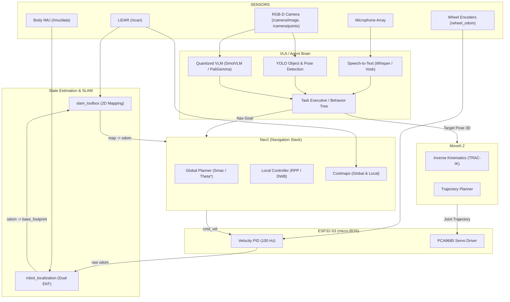
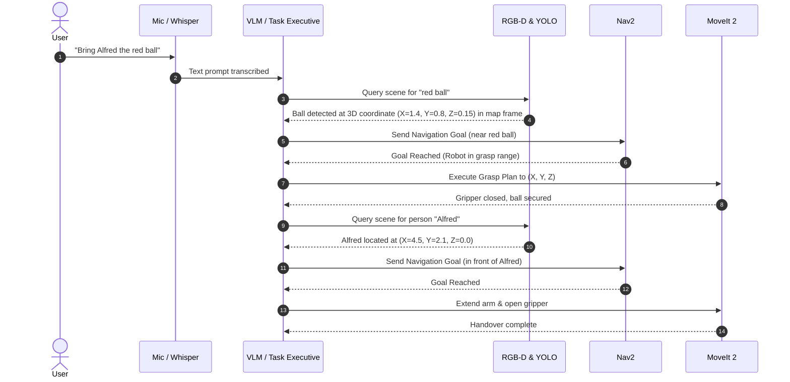

# Compact Lab Rover — ROS 2 Jazzy Mobile Manipulation Robot Architecture

**Project:** Autonomous Mobile Manipulation Robot (Compact Lab Rover)  
**Base:** Deconstructed Xiaomi Robot Vacuum  
**Brain:** Raspberry Pi 5 (8GB RAM, Ubuntu 24.04 LTS, ROS 2 Jazzy Jalisco)  
**Low-Level Controller:** ESP32-S3-DevKitC-1  

---

## 1. System Hardware & Electrical Integration

Referencing the mechanical CAD layout and circuit diagram:

### 1.1 Physical Layer Stack (4 Floors)
```
┌────────────────────────────────────────────────────────┐
│ FLOOR 4 (Top): Pan/Tilt Camera, Mic Array, Solar Ctrl  │
├────────────────────────────────────────────────────────┤
│ FLOOR 3: Raspberry Pi 5 (Brain), ESP32-S3, IMU (Body)   │
├────────────────────────────────────────────────────────┤
│ FLOOR 2: Speakers, 4x Time-of-Flight (ToF) Sensors     │
├────────────────────────────────────────────────────────┤
│ FLOOR 1 (Bottom): Xiaomi Powertrain, Dual Motor Drivers│
│                   Power Dist, 6V 20A BEC, 5V 5A Buck   │
└────────────────────────────────────────────────────────┘
```

### 1.2 Power Tree
* **Main Battery:** 2S LiPo 7.4V (or 3S/4S depending on Xiaomi base motor voltage) with 20A inline fuse, NC Emergency Stop, and main toggle.
* **5V System Power Bus (5.1V / 5A Buck):** Powers Raspberry Pi 5, ESP32-S3, PCA9685 logic, BNO086 IMU, and INA260 power monitor.
* **6V Servo Power Bus (6V / 20A High-Current BEC):** Dedicated isolated high-current rail for PCA9685 servo power pin `V+` driving up to 16 robotic arm and pan/tilt servos.
* **Shared Common Ground:** Essential across Pi 5, ESP32, BEC, regulators, and sensors to prevent ground loops and I2C reference drift.

---

## 2. Sensor Stack Specification & Research

### 2.1 Dual IMU Architecture (Body vs. Camera)
The requirement specifies **2 IMUs**: one on the robot chassis (Body) and one on the pan/tilt camera head.

#### 6-DOF vs. 9-DOF Research & Recommendation
| Feature | 6-DOF (Accel + Gyro) | 9-DOF (Accel + Gyro + Magnetometer) |
| :--- | :--- | :--- |
| **Sensors** | 3-axis Accel + 3-axis Gyro | 3-axis Accel + 3-axis Gyro + 3-axis Compass |
| **Indoor Behavior** | High short-term accuracy; zero magnetic distortion vulnerability | Heavily disturbed by indoor ferromagnetic materials (rebar, steel desks, high-current DC motor wiring, battery magnetic fields) |
| **Drift** | Slow yaw drift over long trajectories | Corrects yaw drift if calibrated, but erratic yaw jumps near motors |
| **Verdict for this Robot** | **RECOMMENDED for Body & Camera** | **NOT RECOMMENDED indoors near high-current motors** |

> [!IMPORTANT]
> **Recommended IMU Configuration:**
> * **Body IMU (Floor 3):** **BNO086 (or BNO085)** operating in **Game Rotation Vector mode** (6-DOF fusion running on the onboard ARM Cortex-M0+ coprocessor). This provides filtered, drift-free orientation (quaternions) at up to 400 Hz without magnetic interference from the wheel motors and 20A BEC.
> * **Camera Pan/Tilt IMU (Floor 4):** A secondary BNO086 or MPU6050 mounted on the camera optical frame. This isolates chassis vibrations from camera tilt angles and enables horizon stabilization and visual-inertial odometry (VIO).

---

### 2.2 LiDAR Selection & Interfacing
* **Xiaomi LDS (Laser Distance Sensor) 2D LiDAR:**
  * Uses 3.3V UART (TX/RX) at 115200 baud, powered with 5V for electronics and ~3V PWM for the motor spin.
  * **Option A:** Connect via USB-to-UART CP2102 adapter into Pi 5 USB port.
  * **Option B:** Upgrade to **RPLiDAR C1** or **LD19 / D300** (enclosed optics, higher sample rate ~5000 pts/sec, resistant to ambient light).
* **ROS 2 Node:** `rplidar_ros` or `hls_lfcd_lds_driver` publishing standard `sensor_msgs/msg/LaserScan` on topic `/scan` at frame `lidar_link`.

---

### 2.3 Vision & Perception (RGB-D / Depth Camera)
The robot brain needs 3D spatial awareness to locate objects (e.g. "red ball" $\rightarrow$ $(X, Y, Z)$ coordinates relative to the arm).
* **Option A: Dedicated RGB-D (Intel RealSense D435i / D405 or Orbbec Astra):**
  * Provides aligned RGB + Depth PointCloud natively over USB 3.0.
  * Supported by official ROS 2 Jazzy packages (`realsense2_camera`).
* **Option B: Hybrid Stereo / Pi Camera Module 3 + ToF Grid:**
  * Uses the CSI-connected Camera Module 3 (wide FOV) on Floor 4 for YOLO detection.
  * Uses 4x ToF sensors (VL53L1X / VL53L5CX 8x8 multizone) on Floor 2 for distance verification and blindspot detection.

---

### 2.4 Wheel Odometry & Xiaomi Vacuum Motor Base
The deconstructed Xiaomi vacuum base contains:
* **Drive Motors:** Left and Right high-torque geared motors.
* **Encoders:** Quadrature Hall or optical wheel encoders.
* **Low-Level Interface (ESP32-S3):**
  * Reads encoder ticks using the ESP32 hardware **Pulse Counter (PCNT)** peripheral.
  * Runs a closed-loop **PID velocity controller at 100 Hz**.
  * Receives target linear velocity $v$ and angular velocity $\omega$ from ROS 2 `/cmd_vel`.
  * Computes differential drive kinematics:
    $$v_L = v - \frac{\omega \cdot L}{2}, \quad v_R = v + \frac{\omega \cdot L}{2}$$
  * Publishes raw odometry (`nav_msgs/msg/Odometry`) and `sensor_msgs/msg/JointState` back to the Pi over micro-ROS or serial bridge.

---

## 3. ROS 2 Jazzy Software Architecture



---

## 4. Coordinate Frames (TF2 Tree)

```
map
 └── odom (published by robot_localization / SLAM)
      └── base_footprint (projection on ground)
           └── base_link (chassis geometric center)
                ├── lidar_link (LDS / RPLiDAR)
                ├── imu_body_link (BNO086 on Floor 3)
                ├── camera_pan_link (Yaw joint)
                │    └── camera_tilt_link (Pitch joint)
                │         ├── camera_optical_frame (Lens focal point)
                │         └── imu_camera_link (BNO086 on head)
                ├── tof_front_link, tof_back_link, tof_left_link, tof_right_link
                └── arm_base_link (Shoulder mount)
                     └── shoulder_link
                          └── elbow_link
                               └── wrist_link
                                    └── gripper_link
```

---

## 5. High-Level Brain: VLA & Task Execution Loop

### Scenario: *"Bring Alfred the red ball"*



---

## 6. Work Division & Subsystem Ownership

| Team Member | Subsystem | Key Responsibilities |
| :--- | :--- | :--- |
| **Athul** | **ROS 2 Core & AI Infrastructure** | ROS 2 Jazzy stack, TF2 tree, URDF, VLA integration, Tailwind UI dashboard |
| **Sam** | **SLAM & Dead Reckoning** | `slam_toolbox`, EKF sensor fusion, wheel odometry calibration, Nav2 tuning |
| **Adil** | **Edge Data & Memory** | Short-term robot state DB on Pi, local vector database (pgvector / sqlite-vec) for semantic memory |
| **Alfred** | **Electrical & Schematics** | Power distribution PCB/bus, wiring harnesses, emergency safety circuits, ESP32 schematic verification |
| **Gautam** | **Cost & Mechanical Modeling** | 2D/3D URDF meshes, BOM cost management, payload balancing across 4 floors |
| **Asel** | **Hardware & Thermal Optimization** | Thermal management for Pi 5 & motor drivers, structural vibration dampening for IMUs/LiDAR |
| **Robin** | **Powertrain & Motor Control** | Xiaomi vacuum motor reverse engineering, H-bridge / BLDC driver circuit, MATLAB motor simulation |
| **Ambrose** | **Solar & Auxiliary Power** | Solar panel integration on Floor 4, MPPT / charge controller telemetry into ROS 2 `/battery_state` |
