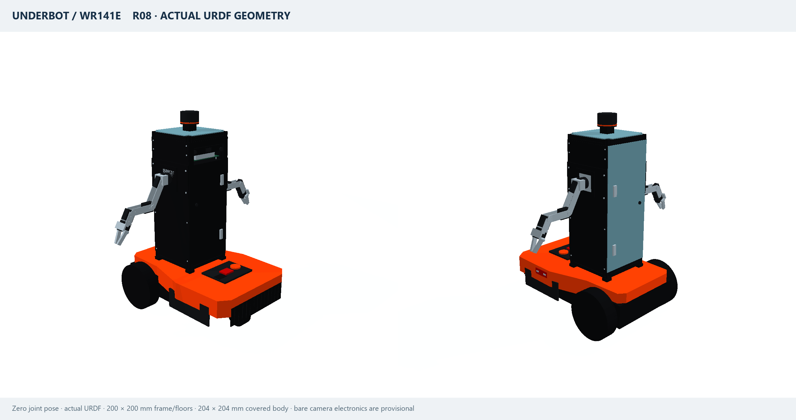

# Underbot

A compact mobile robot built around a **Worx Landroid M500 WR141E**, with two side-mounted arms, internal Kinect electronics and a modular aluminium tower.



**R08 · 200 × 200 mm floors · 204 × 204 mm covered tower · 45 visual meshes**

The preview above is rendered from the delivered robot model. Black aluminium framing, matte-black plastic front/side covers, clear polycarbonate floors and a rear service panel form the tower. The arms attach directly to metal carriers on the frame. The NOCO GB70 stands upright inside; bare Kinect components sit behind an open front optical aperture.

## Download and inspect

- [Download the complete R08 package](downloads/Underbot_WR141E_R08_200mm_description.zip) — extract the whole folder to keep the model and meshes together.
- [Portable URDF](underbot_description/urdf/underbot.portable.urdf) — relative mesh paths for simulator import.
- [ROS URDF](underbot_description/urdf/underbot.urdf) and [modular Xacro](underbot_description/urdf/underbot.urdf.xacro).
- [Offline interactive viewer](underbot_description/viewer.html) — download/clone the repository, then open this file in a browser to inspect the model and move its joints.
- [Dimensioned floor/frame plan](underbot_description/docs/floor_plan_R08.svg).

## Dimensions and articulation

| Feature | Model |
|---|---|
| Base envelope | 558 × 404 × 205 mm |
| Frame and floor bounds | 200 × 200 mm; floor corners relieved around the posts |
| Covered body | 204 × 204 mm, using external 2 mm sheets |
| Vertical posts | Four 20 × 20 × 500 mm profiles |
| Horizontal rails | Sixteen 160 mm cuts from 200 mm stock |
| Clear space between posts | 160 × 160 mm |
| Arms | Two budget kits; five positioning axes plus a coupled gripper per arm |
| Drive | Two powered rear wheels and a passive swivel caster |
| Model structure | 23 links, 22 joints; 14 commands, two passive axes, two mimic followers |
| Estimated total mass | 19.60 kg |

All URDF dimensions use metres, angles use radians, and inertias use kg·m². Body axes are X forward, Y left, Z up. Sensor optical frames follow ROS conventions. Collision geometry and explicit inertial properties accompany the visual meshes.

## Use with ROS 2 / RViz2

Place `underbot_description` in the `src` directory of a ROS 2 workspace:

```sh
colcon build --packages-select underbot_description --symlink-install
source install/setup.bash
ros2 launch underbot_description display.launch.py
```

For Gazebo, Isaac Sim/Lab and Foxglove, follow the [simulation import guide](underbot_description/docs/simulation_import.md). The package includes an optional Gazebo profile and ROS controller templates. Fixed-body merging, mimic handling and actuator setup depend on the target importer and version.

## Validation and measurement status

The delivered R08 geometry passed independent dimension, clearance, joint-transform, mesh, inertia and Xacro checks. MuJoCo checks cover driving, turning, arm commands and coupled jaws. PyBullet independently imports the model, compares joint transforms and renders the preview. A static audit samples 2,000 arm configurations and a full caster rotation. See the [delivery report](underbot_description/validation/delivery_check.json), [physics review](underbot_description/docs/physics_review.md) and [accuracy register](underbot_description/docs/accuracy_and_physics.md).

The bare Kinect layout is a provisional packaging reservation, not measured teardown CAD. Arm pivots, installed masses, actuator ratings and some mounting details remain estimates. Native Gazebo, Isaac Sim/Lab, RViz2 and FreeCAD execution has not been performed; no payload rating is established.

## Package layout

```text
underbot_description/
├── urdf/          # ROS, portable, Gazebo and modular Xacro models
├── meshes/        # 45 visual STL assets in metres
├── config/        # Dimensions, geometry, joint limits and control templates
├── launch/        # ROS 2 display launch
├── rviz/          # RViz configuration
├── cad/           # FreeCAD reconstruction macro and instructions
├── scripts/       # Model generation, viewer and validation tools
├── docs/          # Preview, dimensional plan and engineering notes
├── validation/    # Reports, tested scenes and SHA-256 manifest
└── viewer.html    # Self-contained interactive joint inspector
```

The historical root files `underbot_flat.urdf` and `underbot_standalone.urdf` now contain the same R08 physical model with mesh paths relative to the repository root. `generate_underbot_meshes.py` forwards to the current package builders. For changes after hardware measurements, use the [package rebuild instructions](underbot_description/README.md#rebuild-after-measurements).
