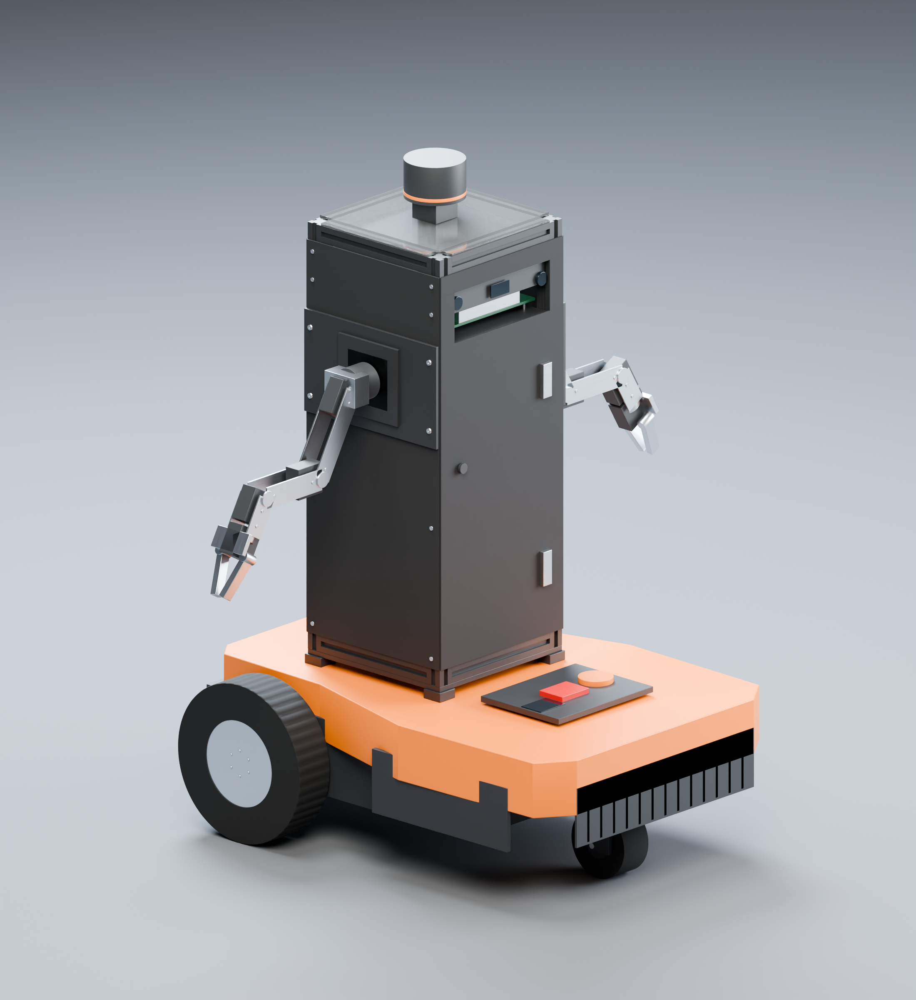

# Underbot R09 — final detailed export

The current design uses **200 × 200 mm floors and frame**, external 2 mm covers giving a **204 × 204 mm body**, and four **20 × 20 × 500 mm posts**. The side arms attach to metal carriers on the frame. Front and side sheets have matte-black vinyl; the frame is black, and the floor plates and rear service sheet are clear polycarbonate.



## Open these files

| File | Purpose | Units |
|---|---|---|
| [Assembled STL](stl/Underbot_R09_assembled_mm.stl) | Complete robot in its assembled zero-joint pose | **Millimetres** |
| [Textured GLB](models/Underbot_R09_textured.glb) | Self-contained PBR model with embedded textures | Metres; glTF Y-up |
| [Blender scene](models/Underbot_R09_studio.blend) | Editable part hierarchy, packed textures and studio lighting | Metres; Z-up |
| [Portable URDF](underbot_description/urdf/underbot.portable.urdf) | Simulation model referencing detailed STL visuals | Metres; ROS axes |
| [Optional textured URDF](underbot_description/urdf/underbot.textured.urdf) | Same physical model with OBJ/MTL visual references | Metres; importer material support varies |
| [Floor/frame plan](docs/floor_plan_R09.svg) | Dimensioned plan with post reliefs and external covers | Labelled in mm |

STL stores surface geometry only. The GLB, Blender scene and OBJ/MTL companions carry surface appearance. The STL assembly contains separate closed component shells, including intentionally contacting or overlapping parts; it is **not a single Boolean-unioned 3D-printing solid**.

Individual component STLs are in `stl/components_mm/`; each uses its own local part frame. Movable-link STLs are in `stl/links_local_mm/`, using the URDF link frames. `geometry_export_manifest.json` supplies every part's assembly transform, mesh bounds and unit designation. Use the assembled STL to open the complete robot directly without applying these transforms yourself.

## Detail and materials

The model contains 250 component objects and 45 URDF visual material groups. Circular surfaces use 128 or 192 segments. Small edge bevels preserve each part's original external dimensions. Recessed wheel hubs, tread grooves within the original tyre radius and shallow screw-head sockets add detail without changing the agreed assembly envelope.

The material library contains 24 tileable 2048 × 2048 PNG maps and 11 materials: matte-black vinyl, painted aluminium, brushed metal, rubber, plastic, PCB soldermask, optical glass, clear polycarbonate, orange/red controls and status lighting. Texture normals affect shading only; they do not displace geometry. These finishes are artistic approximations, not measured factory surface data.

The GLB embeds its textures. All Blender image textures are packed into the scene. OBJ/MTL material support differs between applications; the GLB and Blender scene are the preferred textured deliverables. The ordinary STL URDF remains the compatibility option for ROS/RViz, Gazebo and Isaac importers.

## Dimensions checked

| Item | Nominal dimension | Basis |
|---|---|---|
| Frame and four floor bounds | 200 × 200 mm | User requirement |
| Floor corner reliefs | 20 × 20 mm at each corner | Fits the 20 mm posts |
| Covered tower bounds | 204 × 204 mm | User-approved external 2 mm sheets |
| Posts | Four 20 × 20 × 500 mm | User-specified stock |
| Rails | Sixteen 160 mm lengths | Cut from the specified 200 mm stock to fit between posts |
| Clear opening between posts | 160 × 160 mm | Derived geometry |
| Floor thickness | 3 mm | Existing design assumption |
| Floor top elevations | 228, 503, 578, 708 mm above ground | Existing assembly datums |
| WR141E base envelope | 558 × 404 × 205 mm | Published manufacturer envelope |
| GB70 body, installed upright | 69 D × 99 W × 222 H mm | Manufacturer body drawing, rotated |
| GB70 installation reservation | 70 D × 152 W × 222 H mm | Overall published envelope, rotated |

The 204 mm dimension describes the covered tower only. Arm carriers, arms, hinges and small fasteners extend beyond it. See the [independent dimensional audit](validation/dimensional_audit.md) for measured exported-mesh results, tolerances and remaining assumptions.

## What accuracy means here

The explicitly specified design dimensions are checked against the actual exported triangles. The original Kinect casing is excluded; its bare internal board, cooling and optical layout remains a provisional reservation because the dismantled components have not been measured. Arm pivots and link dimensions, wheel/caster internals, actuator ratings, installed masses and mounting-hole details also remain estimates. The WR141E shell follows the published overall envelope with simplified surface contours. This model therefore is not a factory CAD replica or fabrication certification.

The physical configuration is the tested R08 arrangement: 23 links, 22 joints, 14 commanded joints, two passive caster coordinates and two gripper mimic followers. R09 refines the visual surfaces while preserving collision geometry, joint origins/axes/limits and the estimated 19.601 kg mass/inertia budget. No payload rating is established. Native ROS/RViz2, Gazebo and Isaac Sim/Lab execution has not been performed in this environment.

## Validation and reproduction

- `validation/dimensional_audit.json` / `.md`: independent actual-STL dimension, frame, unit, topology and assembly checks.
- `validation/textured_export_audit.json` / `.md`: inspection of the real GLB materials, embedded textures and resource references.
- `material_checks.json`: source texture dimensions, hashes, normal-map and packed-channel checks.
- `underbot_description/validation/`: URDF authoring, kinematics, inertia, static and independent-engine evidence.
- `validation/final_delivery.json` and `validation/sha256_manifest.json`: final archive inventory and file hashes.

The independent audit reports the exact scope of its checks; sampling does not establish every possible arm pose or hardware performance.

To reproduce the visual export, use Python 3 with NumPy/Pillow and Blender 4.5:

```sh
python scripts/build_R09_materials.py --source underbot_description/config/geometry_manifest.json --output .
blender --background --python scripts/build_final_R09_blender.py -- --source underbot_description/config/geometry_manifest.json --output .
python scripts/integrate_final_R09.py --output .
python scripts/verify_final_R09.py --source underbot_description --final .
python scripts/verify_R09_glb.py --package .
```

Then rebuild the package's offline viewer and rerun its authoring/import checks. Integration replaces visual assets only. Rebuilding after a physical design change requires comparison against a retained baseline and new hardware measurements; comparing a source against itself does not establish unchanged physics.

The Blender scene contains a presentation-only collection with floor, lights and cameras. Those objects are excluded from STL and GLB exports. The cutaway render temporarily hides selected panels to expose the internal arrangement; the assembled deliverables retain all panels.

Published dimension references: [Worx WR141E specifications](https://eu.worx.com/en/robot-mower-landroid-s-robot-mower-for-lawns-up-to-400-m2-wr141e/), [NOCO GB70 specifications](https://no.co/gb70/specs), and [NOCO body drawing](https://no.co/media/wysiwyg/downloads/brochures/Boost/GB70_Data_Sheet_12.05.2024.pdf). Further source and assumption details are in the [accuracy register](underbot_description/docs/accuracy_and_physics.md).
